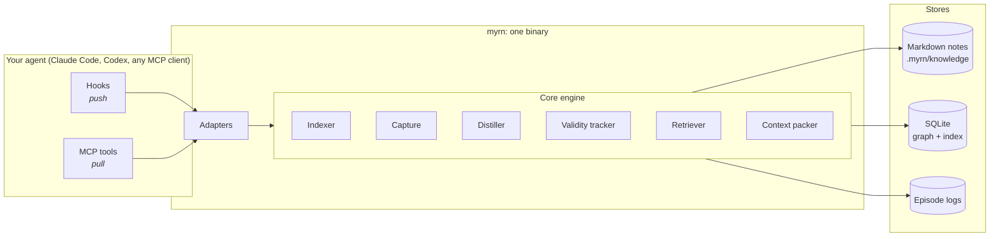

<div align="center">

# 🧠 Myrn

### Git for what your coding agent learns.

**Persistent, local-first project memory for AI coding agents.**
Myrn remembers what your code is, why it's that way, and what was learned while working on it, so your agent doesn't start every session from zero.

[](LICENSE)
[](#roadmap)
[](https://www.rust-lang.org)
[](#platform-support)
[](https://modelcontextprotocol.io)

[Why](#-why) · [How it works](#-how-it-works) · [Quick start](#-quick-start) · [CLI](#-cli) · [Roadmap](#-roadmap) · [Design doc](docs/design/)

</div>

---

> [!NOTE]
> **Phase 0 is done, Phase 1 is half done:** the code graph, the CLI, the MCP pull tools and `myrn connect` (Claude Code and Codex hooks) work today for Rust, Python, JavaScript and TypeScript. Session recording, learned records and the benchmark come next; sections below that describe them are the plan, not shipped behaviour.

## 🤔 Why

Coding agents forget everything between sessions. They re-read the same files, work out the same architecture again, and repeat mistakes an earlier session already diagnosed. You pay for that in **tokens**, **time** and **correctness** on every task.

Myrn gives the agent a memory of the project that updates itself:

| Without Myrn | With Myrn |
|---|---|
| Reads 20 files to find where auth lives | Gets a 1,500-token map of the relevant symbols |
| Debugs the same `401 on refresh` bug again | Recalls the earlier bug, its root cause and the fix |
| Re-learns that the refresh window is in config, not code | Already knows, from a verified fact |
| Trusts notes that went stale three refactors ago | Marks knowledge **suspect** as soon as the code changes |

## ✨ Features

- **🕸️ Code knowledge graph.** Files, symbols, calls, imports and tests, parsed with Tree-sitter. No model needed.
- **📓 Learned experience.** Decisions, bugs, root causes, fixes and verified workflows captured from agent sessions.
- **🎯 Context that fits the task.** Before the agent starts, Myrn walks the graph from the task and fits the most relevant knowledge into a hard token budget.
- **🔁 Recall on failure.** When a test fails, Myrn matches the error to earlier bugs and shows their causes and fixes.
- **🧪 Never serves stale knowledge as fact.** Every record is tied to hashes of the code it describes. Change that code and the record is marked suspect and ranked down.
- **🔒 Local and readable.** Plain Markdown notes plus one SQLite file. No account, no server, no cloud. You can trace, edit or delete any record.
- **🤝 Works with your agent.** Claude Code, Codex or any MCP client. You keep typing `claude` or `codex`.
- **🌿 Shared through Git.** Publish a record and it goes through code review like any other file.

## ⚙️ How it works



**One prompt, end to end:**

1. You type a prompt in your agent.
2. The agent's prompt hook calls `myrn`.
3. The indexer refreshes any files that changed.
4. The retriever walks the graph from the task, and the packer fits the result to the token budget.
5. The context goes back to the agent as hook output.
6. While it works, the agent can call `recall`, `explain` or `impact` for more.
7. At session end, the agent writes what it learned. Myrn checks each record against its evidence before storing it.

### What a symbol card looks like

```text
function   auth::session::refresh         src/auth/session.rs:42-88
signature  fn refresh(token: &Token) -> Result<Session, AuthError>
summary    Issues a new session when the token is expired but still
           inside its refresh window.
calls      TokenStore::lookup, Clock::now, Session::new
called by  middleware::require_auth, api::login::renew
tests      tests/auth/refresh_expired.rs
known      bug-7f3a91 (fixed in 4be2a07): returned 401 for expired sessions
           refresh-window-config: window is set in config, not code
status     current (body hash matches)
```

## 🚀 Quick start

There are no prebuilt binaries yet. Build from source with Rust 1.85 or newer and a C compiler:

```sh
cargo install --path crates/myrn
```

Then, in any Git repository:

```sh
cd my-project
myrn init                          # index the code and Git history (no session data is recorded)
myrn explain refresh_session       # one symbol: signature, callers, callees, tests, commits
myrn impact TokenStore::lookup     # everything that depends on it, and the tests that reach it
myrn context "fix the 401 on expired sessions"   # the pack an agent would get for this task
```

### Connect your agent

```sh
myrn connect                 # Claude Code or Codex, whichever is installed; asks before installing hooks
myrn connect --pull-only     # just the MCP tools plus one line in CLAUDE.md / AGENTS.md; nothing recorded
myrn disconnect              # remove everything connect wrote
```

`connect` explains what session hooks will see and asks y/N (default no). Then it writes:

- **Claude Code:** hooks in `.claude/settings.local.json` (not committed), each calling `myrn hook claude <event>` directly, with no shell script, and the MCP server through `claude mcp add --scope local`.
- **Codex:** hooks in `.codex/hooks.json` and the MCP server in `.codex/config.toml`. Codex reads these only in trusted projects. Both files hold this machine's path to `myrn`, so don't commit them.

The agent gets four tools: `context`, `explain`, `impact` and `history`. Automatic context injection is **off** by default (`[context] inject = false` in `.myrn/project.toml`) until the benchmark shows it saves tokens; with it on, the prompt hook adds a context pack in about 20 ms. `myrn doctor` shows exactly what was written and flags anything that has drifted.

## 🛠️ CLI

If you know Git, you can guess most of these.

| Command | Git analogue | What it does | |
|---|---|---|---|
| `myrn init` | `git init` | Index the repository and create the local store | ✅ |
| `myrn status` | `git status` | Index health, record counts by state, connected agents | ✅ |
| `myrn show <id>` | `git show` | One node with its fields and relations | ✅ |
| `myrn rebuild` | | Recreate the index from the code and the notes | ✅ |
| `myrn doctor` | | Diagnose store, index and setup problems | ✅ |
| `myrn explain` / `impact` / `history` / `context` / `brief` | | Same answers the MCP tools give | ✅ |
| `myrn mcp` | | MCP server over stdio, started by the agent | ✅ |
| `myrn connect` | | Install agent hooks and the MCP server, after asking for consent | ✅ |
| `myrn disconnect` | | Remove everything `connect` wrote | ✅ |
| `myrn log` | `git log` | History of episodes, decisions and learned records | planned |
| `myrn diff` | `git diff` | How project knowledge changed between two points | planned |
| `myrn trace <id>` | `git blame` | Where a record came from: session, commit or test | planned |
| `myrn verify` | | Re-check suspect records against the current code | planned |
| `myrn forget <id>` | | Permanently remove a record | planned |
| `myrn gc` | `git gc` | Merge duplicates, compact episodes, tidy the index | planned |
| `myrn publish <id>` | `git add` | Move a private record into the shared knowledge directory | planned |

Add `--json` to any command for machine-readable output.

## 🧭 Design principles

1. **Wrong memory is worse than no memory.** Every record carries evidence and a validity state.
2. **Zero setup.** One binary, two commands. No account, API key, database server or model download.
3. **Local and readable.** Plain files and one SQLite file, each record traceable to where it came from.
4. **Derived knowledge can be rebuilt; learned knowledge is kept.** Anything computed from the code can be regenerated. Lessons from sessions are never silently deleted.
5. **The agent stays the interface.** No new window, no new workflow.
6. **Consent before capture.** Indexing code needs no permission. Recording sessions is off until you agree.
7. **Measured, not assumed.** Automatic context injection stays opt-in until a benchmark shows it saves tokens without hurting results.

## 🔐 Privacy

- **Nothing leaves your machine** unless you commit it. The core makes no network calls.
- **Secrets are redacted** before anything is written.
- **Private memory lives outside the repo**, so `git add .` can't pick it up.
- **Shared records are shown to agents as quoted reference**, never as instructions.

## 🗺️ Roadmap

- [x] Architecture and design ([docs/design/](docs/design/))
- [x] Repository scaffold ([docs/structure.md](docs/structure.md))

### Phase 0: code graph and pull tools (steps 1–9) ✅

- [x] 1. Project setup
- [x] 2. SQLite store
- [x] 3. Tree-sitter code indexer (Rust, Python, JavaScript, TypeScript)
- [x] 4. Call, import and test links
- [x] 5. Git history
- [x] 6. First CLI commands: `init`, `status`, `show`, `rebuild`, `doctor`
- [x] 7. Search
- [x] 8. Context packing
- [x] 9. MCP server
- [x] 🚦 **Gate 0:** are `explain` and `impact` answers correct? Passed; see [docs/gate0.md](docs/gate0.md)

### Phase 1: hooks and session capture (steps 10–13)

- [x] 10. Adapter contract, Claude Code adapter, `myrn connect`, hook latency
- [x] 11. Codex adapter and pull-only mode
- [ ] 12. Episode capture and secret redaction
- [ ] 13. 🚦 **Gate 1:** paired benchmark (fewer tokens, no drop in task success)

### Later phases

- [ ] **Phase 2:** learned records (Markdown notes, `record` and `recall` tools); gate: hand-reviewed precision
- [ ] **Phase 3:** validity tracking (hash anchors, suspect records, `verify`, `forget`, `gc`); gate: stale-injection rate
- [ ] **Phase 4:** learning loop (usage-driven ranking, optional embeddings); gate: benchmark
- [ ] **Phase 5:** sharing through Git (`publish`, import, injection safety), then releases

Each phase is usable when it ships. The next phase starts only after the gate before it passes.

## <a id="platform-support"></a>💻 Platform support

Linux, macOS and Windows from the first release, on x86-64 and ARM64, with the same commands and the same note format everywhere.

## 📂 Project layout

```text
crates/
  myrn/           CLI binary
  myrn-model/     data types and the fixed relation list
  myrn-store/     SQLite graph and index, Markdown notes
  myrn-engine/    indexer, capture, distill, validity, retrieve, pack
  myrn-mcp/       MCP server and tools
  myrn-adapters/  Claude Code, Codex, pull-only
  myrn-embed/     optional embedding helper
bench/            with/without benchmark
```

See [docs/structure.md](docs/structure.md) for details.

## 🤝 Contributing

Myrn is at an early stage, and design feedback is the most useful contribution right now. Open an issue to discuss the [design doc](docs/design/) before sending large changes.

```sh
git clone https://github.com/NickStrain/Myrn-.git
cd Myrn-
cargo test --workspace   # includes the Gate 0 suite
```

## 📜 License

[Apache-2.0](LICENSE)

<div align="center">
<sub><code>myrn</code> is a working name.</sub>
</div>
