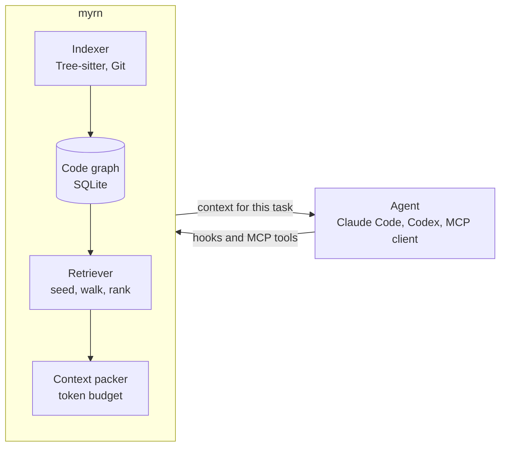

<div align="center">

<h1>Myrn</h1>

<p><strong>Persistent project memory for AI coding agents.</strong></p>

<p>
Myrn maps your codebase into a graph of symbols, calls, tests and history,<br>
and gives Claude Code, Codex or any MCP agent the context a task needs before it starts exploring.
</p>

<p>
<a href="https://github.com/NickStrain/Myrn-/actions/workflows/ci.yml"></a>
<a href="LICENSE"></a>
<a href="https://modelcontextprotocol.io"></a>
<a href="#roadmap"></a>
</p>

<p>
<a href="#quick-start">Quick start</a> ·
<a href="#how-it-works">How it works</a> ·
<a href="#comparison">Comparison</a> ·
<a href="#roadmap">Roadmap</a> ·
<a href="docs/design/">Design doc</a>
</p>

</div>

---

Coding agents start every session with no memory of the project. They re-read the same files, work out the same architecture again, and repeat mistakes an earlier session already diagnosed. Myrn is a single local binary that keeps that knowledge for them, so it doesn't have to be rediscovered on every task.

```console
$ myrn init
Initialised myrn in ~/code/ripgrep
  indexed 102 files: 3,469 symbols, 500 commits in 3.3s

$ myrn explain BinaryDetection::quit
method     searcher::BinaryDetection::quit    crates/searcher/src/searcher/mod.rs:79-81
signature  pub fn quit(binary_byte: u8) -> BinaryDetection
summary    Binary detection is performed by looking for the given byte.
calls       searcher::BinaryDetection  crates/searcher/src/searcher/mod.rs:55
called by   BinaryDetection::from_low_args  crates/core/flags/hiargs.rs:1159-1175
            search                          crates/grep/examples/simplegrep.rs:32-69
tests       json::tests::binary_detection    crates/printer/src/json.rs:922-947
            standard::tests::reports_binary  crates/printer/src/standard.rs:1804-1827
            searcher::glue::tests::binary1   crates/searcher/src/searcher/glue.rs:700-709
            …
status     current (indexed body hash 886ba5f5364ff42f)
```

<sub>Real output on <a href="https://github.com/BurntSushi/ripgrep">ripgrep</a>. One card replaces a round of file reads: what the function is, who calls it, what it calls, which tests cover it, and the exact lines to open.</sub>

## Contents

- [Features](#features)
- [Quick start](#quick-start)
- [Usage](#usage)
- [How it works](#how-it-works)
- [Comparison](#comparison)
- [Benchmarks](#benchmarks)
- [Privacy](#privacy)
- [Roadmap](#roadmap)
- [FAQ](#faq)
- [Contributing](#contributing)
- [License](#license)

## Features

- **Code graph.** Files, symbols, calls, imports, tests and Git history for Rust, Python, JavaScript and TypeScript, parsed with Tree-sitter. No LLM, API key or GPU involved.
- **Task-sized context.** Describe a task and get the relevant symbols, their callers, callees and tests, packed into a hard token budget. If nothing is relevant, nothing is returned.
- **Impact analysis.** See everything that depends on a symbol, up to three calls away, and the tests that reach it, before you change it.
- **Always current.** Only files whose content changed are re-parsed. A refresh with no changes takes about 10 ms, so it runs on every call.
- **Honest about uncertainty.** Every call link is either resolved through scope, imports and types, or marked as inferred from a name match.
- **Works with your agent.** Hooks and MCP tools for Claude Code and Codex; any other MCP client can use the server directly.
- **Local and inspectable.** One binary, one SQLite file, no network calls, and nothing recorded without consent.

## Quick start

Prebuilt binaries are planned. For now, build from source with Rust 1.85 or newer and a C compiler:

```sh
git clone https://github.com/NickStrain/Myrn-.git
cargo install --path Myrn-/crates/myrn
```

Then, in any Git repository:

```sh
myrn init       # index the code and its history
myrn connect    # set up Claude Code or Codex (asks before installing hooks)
```

Keep using `claude` or `codex` as usual. Run `myrn doctor` at any time to see exactly what was configured.

## Usage

### From your agent

`myrn connect` gives the agent four MCP tools:

| Tool | Example input | Returns |
|---|---|---|
| `context` | `fix the 401 when a session expires` | Relevant symbols with locations, callers, callees and tests, within a token budget |
| `explain` | `Session::refresh` | A card for one symbol or file, as shown above |
| `impact` | `TokenStore::lookup` | Direct and indirect callers, importing files, and covering tests |
| `history` | `src/auth/` | Commits that changed a file, directory or symbol |

Hooks can also inject this context automatically at session start and on every prompt. That is off by default (`[context] inject = false` in `.myrn/project.toml`) until the benchmark shows it saves more tokens than it adds.

### From the command line

The same answers are available as commands:

```sh
myrn explain src/auth/session.rs:42           # a symbol by name, qualified name, path or path:line
myrn impact Session::refresh
myrn context "why does refresh return 401"
myrn history src/auth/
```

<details>
<summary>All commands</summary>

<br>

| Command | Description | Status |
|---|---|---|
| `myrn init` | Index the repository and create the local store | Available |
| `myrn status` | Index health, record counts, connected agents | Available |
| `myrn explain <symbol>` | Signature, summary, callers, callees, tests and commits | Available |
| `myrn impact <symbol>` | Dependents and covering tests | Available |
| `myrn context "<task>"` | The context pack an agent would receive | Available |
| `myrn history <path>` | Commits that changed a file, directory or symbol | Available |
| `myrn brief` | The project overview given at session start | Available |
| `myrn show <id>` | One node with all its relations | Available |
| `myrn connect` | Install agent hooks and the MCP server, after consent | Available |
| `myrn disconnect` | Remove everything `connect` installed | Available |
| `myrn doctor` | Check the store, the index and each agent's setup | Available |
| `myrn rebuild` | Recreate the index from scratch | Available |
| `myrn mcp` | MCP server over stdio, started by the agent | Available |
| `myrn log`, `trace`, `diff` | History and origin of learned knowledge | Planned |
| `myrn verify`, `forget`, `gc` | Keep learned knowledge correct and tidy | Planned |
| `myrn publish <id>` | Share a record with your team through Git | Planned |

Every command accepts `--json`.

</details>

## How it works



1. **Index.** Tree-sitter parses each file into symbols with qualified names, signatures, line ranges and a hash of their syntax tree. Calls, imports and tests are resolved across files, and commits are linked to the symbols they changed.
2. **Refresh.** Each call compares file hashes and re-parses only what changed. Formatting-only edits don't change a symbol's hash.
3. **Retrieve.** A task is matched to seed symbols by name, path and full-text search. The graph is walked from those seeds, and the results are ranked.
4. **Pack.** Results are packed into a token budget: one line per item first, then full cards for the most relevant few.

There is no daemon. Each hook or tool call starts the binary, answers from SQLite and exits.

## Comparison

| | Re-reading files | `CLAUDE.md` notes | Vector search | Myrn |
|---|---|---|---|---|
| Knows who calls what | No | No | No | Yes |
| Knows which tests cover a function | No | No | No | Yes |
| Updates when code changes | n/a | By hand | Re-embedding | Incremental, ~10 ms |
| Flags knowledge that went stale | n/a | No | No | Planned (Phase 3) |
| Remembers bugs and fixes across sessions | No | By hand | No | Planned (Phase 2) |
| Runs offline without an API key | Yes | Yes | Usually not | Yes |

## Benchmarks

Measured on public repositories with a release build. Methodology and samples are in [docs/gate0.md](docs/gate0.md).

| Measurement | Result |
|---|---|
| Index ripgrep (Rust, 102 files, 500 commits) | 3.3 s |
| Index requests (Python) and ky (TypeScript) | 1.4 s and 5.0 s |
| Refresh with no changes | ~10 ms |
| Prompt hook with context injection, on ripgrep | 16–19 ms |
| Call graph on a hand-checked fixture in three languages | Exact match, no wrong links |
| Hand-checked call links on real repositories | No wrong links in the final sample |
| Token savings per task | Not yet measured; this is the next gate |

## Privacy

- The core makes no network calls. There is no account, server or telemetry.
- Indexing code needs no permission. Recording agent sessions needs explicit consent in `myrn connect`, and the default answer is no.
- The database lives in your user data directory, outside the repository, so it can't be committed by accident.
- `myrn disconnect` removes every hook and configuration line that `connect` added.

## Roadmap

Each phase ships something usable, and the next phase starts only after its gate passes.

| Phase | Scope | Status |
|---|---|---|
| 0. Code graph | Symbols, calls, imports, tests, Git history, CLI, MCP tools | Done ([gate report](docs/gate0.md)) |
| 1. Hooks | `myrn connect` for Claude Code and Codex; session recording with secret redaction; benchmark gate | In progress |
| 2. Memory | Learned records as Markdown notes: decisions, bugs, root causes, workflows | Planned |
| 3. Validity | Records anchored to code hashes, flagged when the code changes | Planned |
| 4. Learning loop | Ranking from what actually helped; optional local embeddings | Planned |
| 5. Team sharing | Publish knowledge through Git and review it in pull requests | Planned |

<details>
<summary>What a card will look like once Phases 2 and 3 land</summary>

<br>

```text
function   auth::session::refresh         src/auth/session.rs:42-88
signature  fn refresh(token: &Token) -> Result<Session, AuthError>
summary    Issues a new session when the token is expired but still inside its refresh window.
calls      TokenStore::lookup, Clock::now, Session::new
called by  middleware::require_auth, api::login::renew
tests      tests/auth/refresh_expired.rs
known      bug-7f3a91 (fixed in 4be2a07): returned 401 for expired sessions
           refresh-window-config: window is set in config, not code
status     current (body hash matches)
```

The `known` lines are what agents learned in earlier sessions, tied to the code they describe. If that code changes, the record is shown as possibly outdated instead of as fact.

</details>

## FAQ

**Does it send my code anywhere?**
No. Myrn is one local binary and one SQLite file, and it makes no network calls.

**Which agents are supported?**
Claude Code and Codex get hooks and MCP tools through `myrn connect`. Any other MCP client can run `myrn mcp`, and `myrn connect --pull-only` adds a one-line hint to `CLAUDE.md` or `AGENTS.md`.

**Which languages?**
Rust, Python, JavaScript and TypeScript (including TSX). Each language is one module in `crates/myrn-engine/src/indexer/lang/`.

**Do I need an API key, a GPU or a vector database?**
No. Parsing uses Tree-sitter and search uses SQLite full-text search. Optional local embeddings are planned, but nothing will depend on them.

**Will it fill my agent's context window?**
Context packs have a hard budget (about 1,500 tokens per prompt and 500 at session start), and nothing is injected when nothing is relevant. Automatic injection is off by default.

## Contributing

Myrn is at an early stage, and feedback shapes it most right now.

- **Report wrong answers.** If `explain` or `impact` gets something wrong on your repository, open an issue with the symbol and what you expected.
- **Add a language.** Go, Java and C# are the most requested.
- **Discuss the design.** The [architecture document](docs/design/) describes where the project is going.

```sh
git clone https://github.com/NickStrain/Myrn-.git && cd Myrn-
cargo test --workspace
```

See [docs/structure.md](docs/structure.md) for the code layout and [docs/BUILD_PROMPTS.md](docs/BUILD_PROMPTS.md) for the build plan.

## License

Licensed under the [Apache License 2.0](LICENSE). `myrn` is a working name.
